# Google AdSense 添加付款信息（收款方式）完整教程

AdSense 有了收入以后，想把钱真正拿到手，中间还要过好几关：填美国税务信息（W-8BEN）、验证身份、输入寄到家里的 PIN 码、再绑定银行账户。我是用自己的站点 [Uwarp](https://www.uwarp.design/)（一个免费的在线设计工具集合）申请的 AdSense，从头走了一遍，下面按实际顺序把每一步截图和填写要点整理出来，给同样在中国大陆做 AdSense 的朋友参考。

整个流程大致是：**税务信息 → 身份验证 → 地址 PIN 码验证 → 添加银行电汇收款方式 → 达到起付金额后收款**。

---

## 一、填写美国税务信息（W-8BEN）

### 第 1 步：进入「管理税务信息」，点「添加税务信息」

路径是 **支付 → 设置 → 管理税务信息**。在「美国」这一栏下面点「添加税务信息」，会弹出一个「前期准备」的提示，里面说预计需要 10 到 20 分钟，中途可能要再次验证身份，并且表单必须由收款人本人或授权代表签署。看完点「开始填表」。

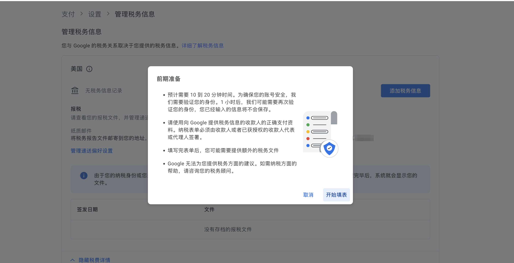

### 第 2 步：验证是本人

接着会提示「验证是您本人」，系统会打开一个新窗口让你重新登录。如果开了弹窗拦截，记得先关掉，不然新窗口出不来。点「下一步」。

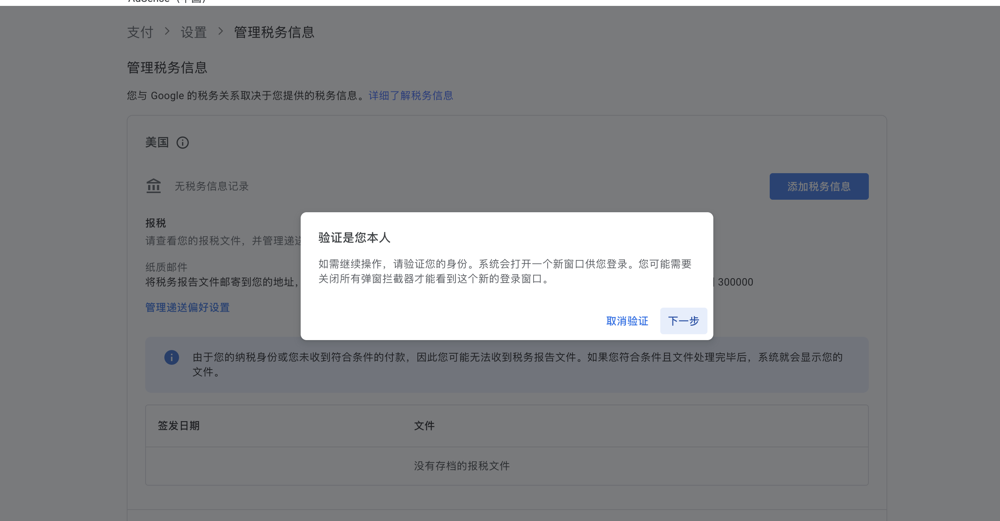

我用的是通行密钥（Passkey）登录，弹出确认框后点「继续」就行，用密码登录也可以。

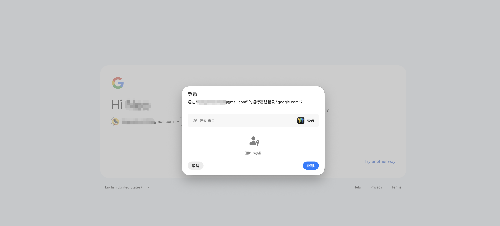

### 第 3 步：回答账号类型问题，选择 W-8BEN 表

进入「美国税务信息」页面，先回答两个问题：

- 是什么类型的账号？我选的是 **个人**
- 是否为美国的公民或居民？选 **否**

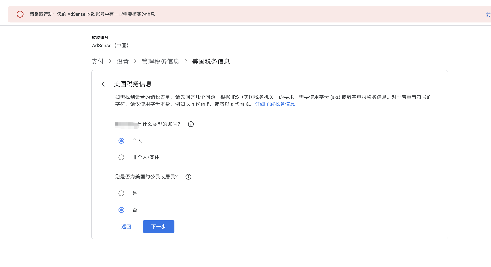

点「下一步」后，页面会让你选 W-8 纳税表。个人选 **W-8BEN**（非美国个人最常用的表单，还能申报税收条约优惠），然后点「打开 W-8BEN 表单」。

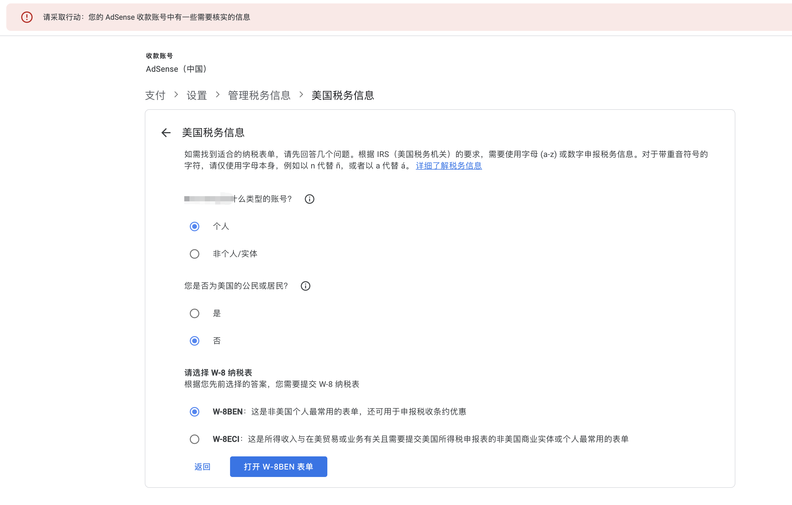

注意页面上的提示：按 IRS 要求，只能用字母（a-z）或数字填写，带重音符号的字符要用字母本身代替。

### 第 4 步：① 纳税身份

刚打开的表单是空的，「受益所有人的姓名」是必填项。

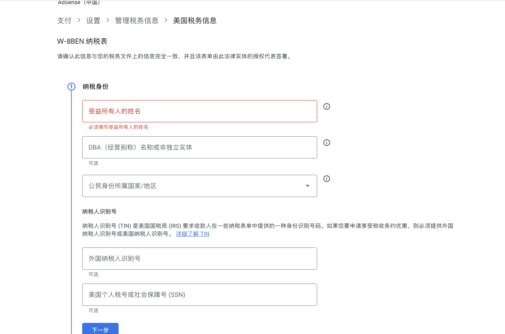

我的填法：

- **受益所有人的姓名**：和护照上的姓名拼写完全一致，标点、空格都不要有差异。
- **DBA（经营别称）名称或非独立实体**：建议留空。除非你有在美国注册使用、不同于个人姓名的商业名称，普通个人不用填。
- **公民身份所属国家/地区**：中国。
- **外国纳税人识别号**：填中国居民身份证号码。页面上虽然标着「可选」，但要申请税收协定优惠就必须提供，所以别留空。
- **美国个人税号或社会保障号 (SSN)**：没有就留空。

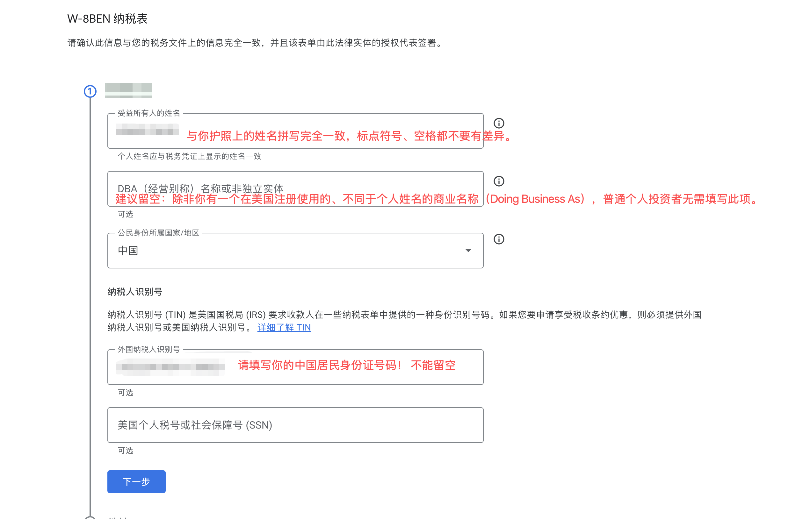

### 第 5 步：② 地址

- 「永久居住地址为邮政信箱或转交地址」这个复选框**不需要勾选**，它是专门给 P.O. Box 或转交地址用的。
- 居住国家/地区选中国，再依次填邮编、省、市、区、街道地址、门牌号。
- 地址同样只用英文字母和数字，比如街道地址写成「No. 15, Building 302」这种格式，城市写 Hangzhou，省写 Zhejiang，邮编写 310000（这里只是举例，按你自己的实际地址填）。
- 下面的「邮寄地址与永久居住地址相同」我是勾上的。

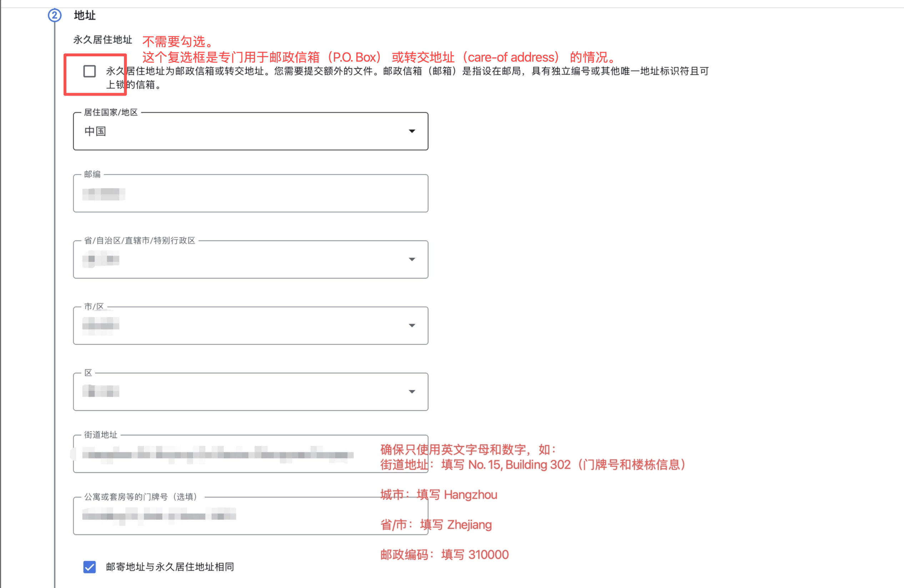

### 第 6 步：③ 税务协定（这一步决定扣多少税）

页面会提示「中国与美国签订了税收条约」。问你是否要依据税收条约申请降低预扣税率：

- 选「**是，我有资格享受更低的预扣税率**」
- 勾选「与美国签订了所得税条约的以下国家/地区的居民」，国家选 **中国**

下面的「特殊税率与条件」里，勾选「**服务或其他商业收入（如 AdSense，但不包括 AdSense YouTube 广告）**」，然后：

- 条款和段落：**第 7 条第 1 段**
- 预扣税率：**0%（较低的税收条约…）**
- 勾选下面那条适用协定条款原因的声明

按美国税法规定，「源自美国」的收入默认要预扣 30%，申报了税收协定后，AdSense 这类服务收入可以降到 0%。

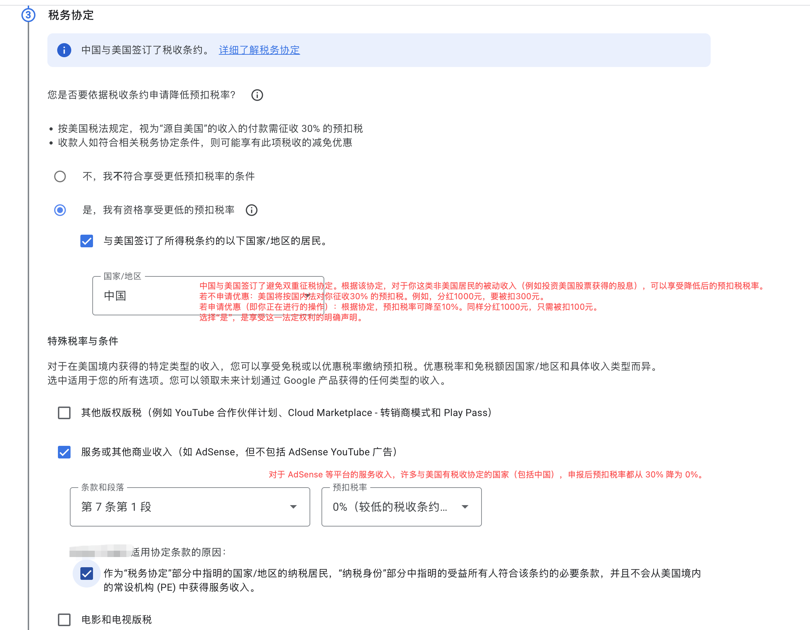

### 第 7 步：④ 在美国进行的活动和服务

问你是否在美国针对 Google 开展过任何活动或提供服务，选 **否**，并勾选下面「服务完全在美国境外履行」的确认声明，点「下一步」。

我的理解是：内容都是在美国境外做的，在美国也没有办公室、员工之类的「常设机构」，所以选「否」，这也是能享受 0% 预扣税率的前提。选「否」不会影响你的广告给美国用户展示。

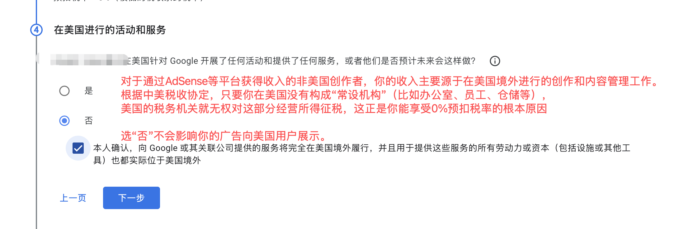

### 第 8 步：⑤ 报税

税务文件递送方式选「**无纸化（推荐）**」，以电子方式接收税务文件，点「下一步」。

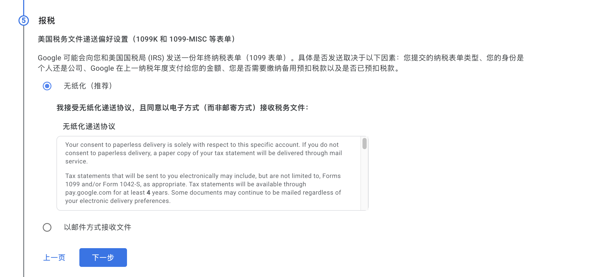

### 第 9 步：⑥ 文件预览

系统会根据你填的内容生成 W-8BEN 表单 PDF，我这里生成了两份（「服务」和「未应用任何税收条约」）。可以点开检查一下，然后勾选「我确认我已尽我所知检查所生成的税务文件……」，点「下一步」。

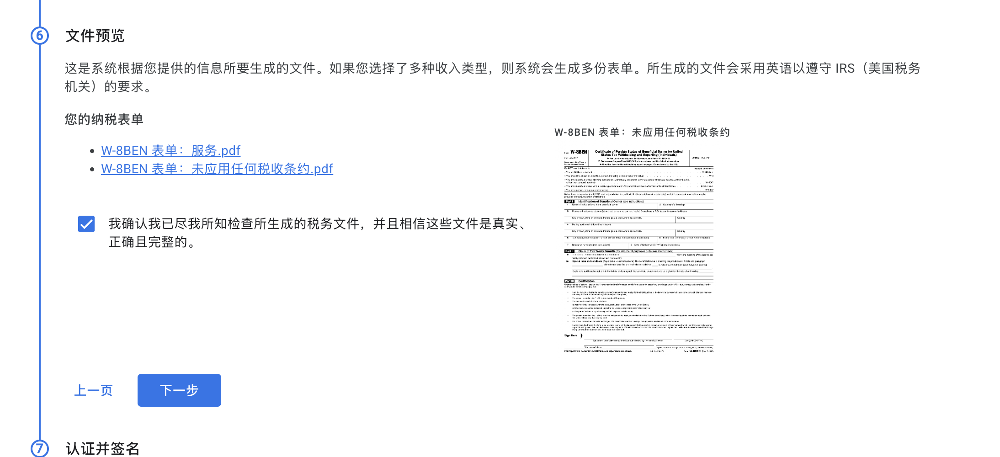

### 第 10 步：⑦ 认证并签名

勾选「本人在此作出如下声明，如作伪证，愿受处罚」，最下面的电子签名部分，确认自己是「纳税身份」部分所列的受益所有人，然后提交。

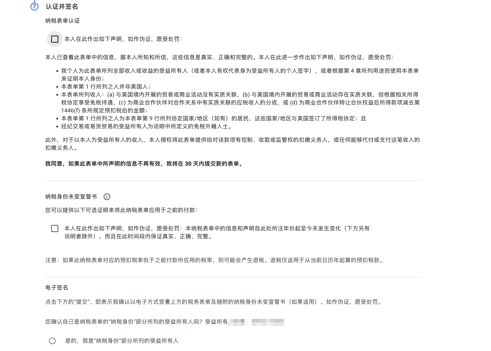

### 第 11 步：如果提示「缺少文件」，上传姓名证明

我提交后弹出了「缺少文件」，原因是「您的法定姓名和账号名称不符」，要求上传姓名证明。可接受的文件有驾照、护照、纳税人证书、政府核发的其他身份证件或合理的书面说明，支持 PDF、PNG、JPEG，小于 50 MB。上传后点「提交文件」。

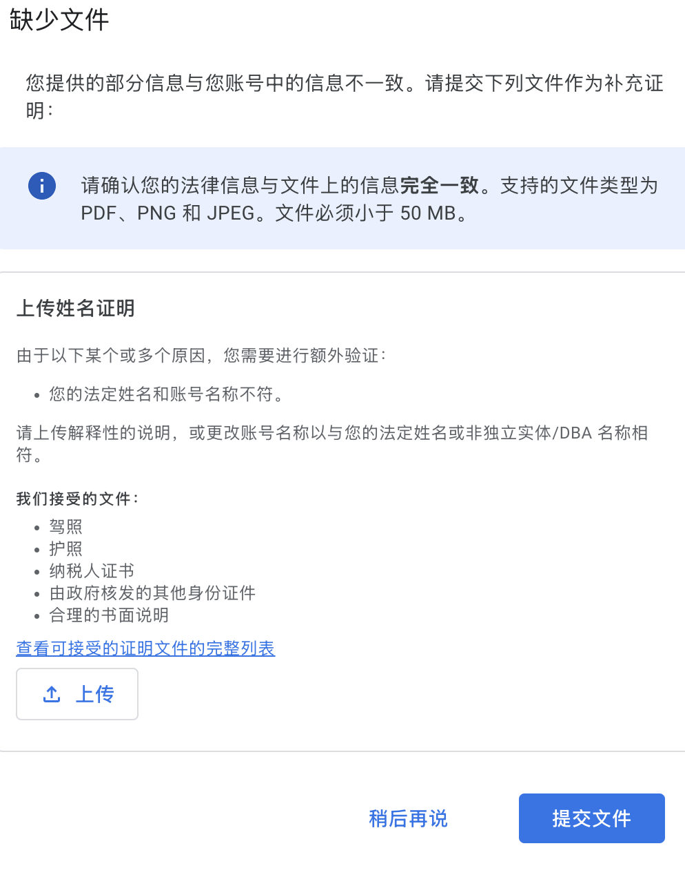

### 第 12 步：等待审核

提交完回到「管理税务信息」，可以看到 W-8BEN 表单状态是「**审核中**」。

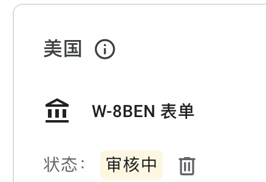

下面那条「可能无法收到税务报告文件」的蓝色提示是正常的，不用管。

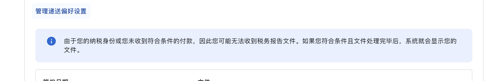

---

## 二、身份验证和地址 PIN 码验证

### 第 13 步：提交身份验证

身份验证资料提交完，会看到「干得漂亮，接下来交给我们吧」的页面，意思是 Google 要做一些检查，之后会联系你。

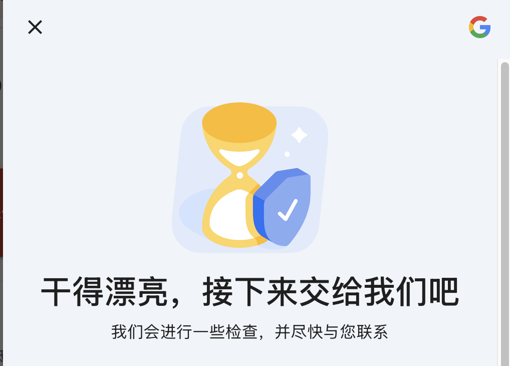

这段时间 AdSense 的「支付」页面顶部会显示红色提示「系统正在对您的身份信息进行验证。验证过程需要几天时间才能完成」。这时候我的收入才 US$9.33，离 US$100 的起付金额还远，所以不急，慢慢等就行。

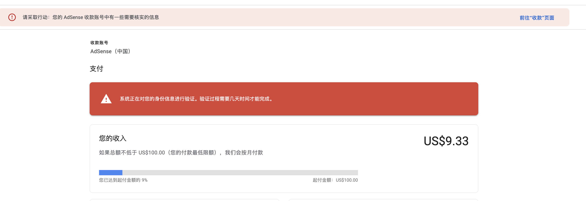

### 第 14 步：输入邮寄来的 PIN 码

身份验证通过后，「验证您的身份」页面里身份验证显示「已完成」，地址验证显示「需要注意」。Google 会把一封带 6 位 PIN 码的信寄到你的收款地址，收到后填进去点「提交」。

注意输入框下面写着「您还可以再试 3 次」，别乱试。如果一直没收到信，可以点「重新发送 PIN 码」。

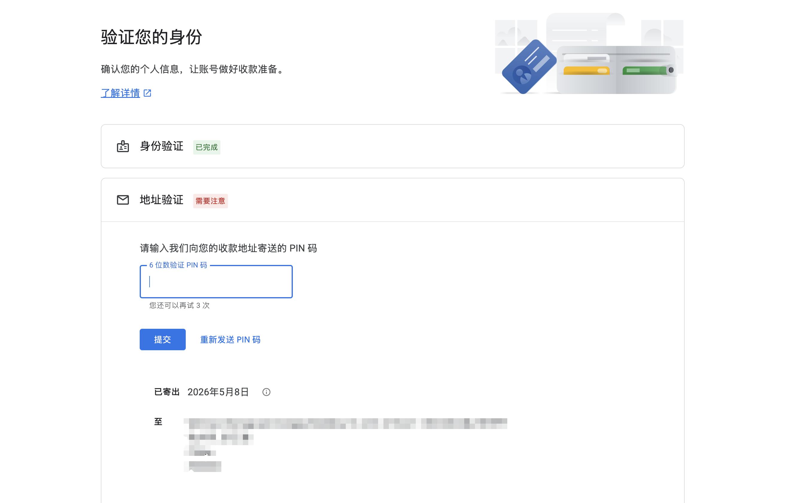

PIN 码提交成功后，身份验证和地址验证都变成「已完成」。

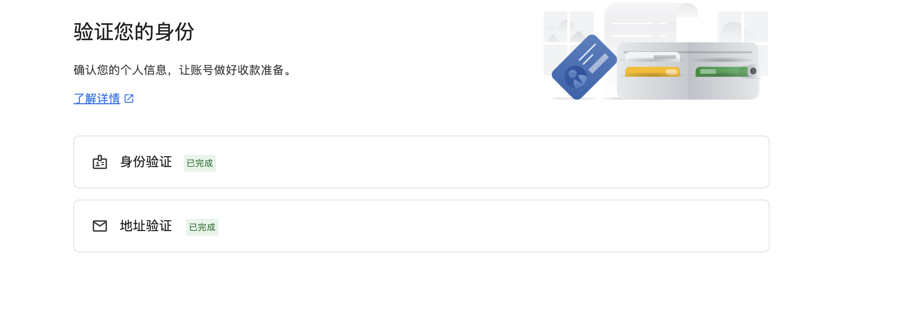

---

## 三、添加银行收款方式（电汇）

### 第 15 步：准备好要填的银行信息

我用的是中国银行的卡，填写前先整理了一张对照表（下面的姓名是示例「张小明」，不是真实信息）：

| 字段 | 怎么填 |
|---|---|
| 收款人 ID | 可选，留空 |
| 银行账户上的姓名 | 开户人姓名全拼，大写，姓在前名在后，中间空格，例如 ZHANG XIAOMING |
| 银行名称 | 银行官方英文名，例如 BANK OF CHINA 或 BANK OF CHINA LIMITED |
| SWIFT/BIC | 8 位或 11 位，中行总行代码为 BKCHCNBJ，需要指定分行时在后面加 3 位分行代码，例如北京分行 BKCHCNBJ110 |
| 账号 / 重新输入账号 | 完整的储蓄卡卡号，两次一致 |
| 中转银行 | 个人收款一般留空 |
| 最终汇入方/最终收款人 | 一般留空 |
| 设为主要支付方式 | 勾选 |

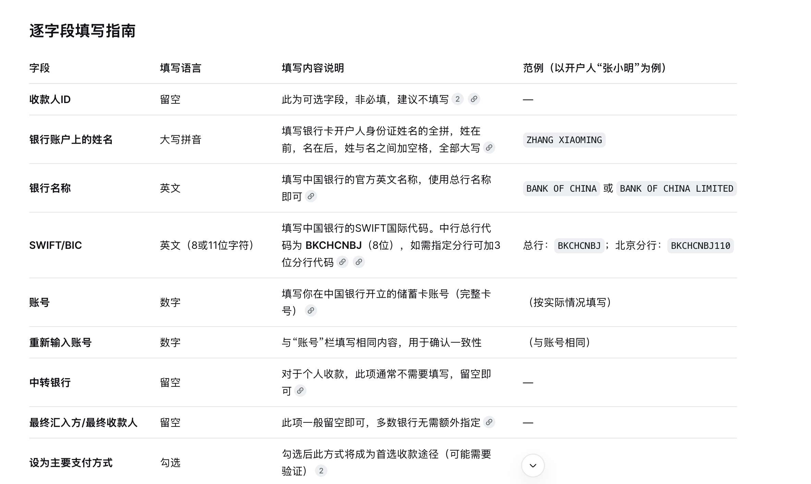

### 第 16 步：填写收款信息并保存

在 **支付 → 支付方式 → 添加支付方式** 里选电汇，按上面的对照表填好「收款信息」，勾选「**设为主要支付方式**」，点「保存」。

页面上写着中转银行「只有美国境内的电汇需要经过中转银行」，所以中转银行名称和中转银行 SWIFT-BIC 我都留空了。另外注意勾选主要支付方式下面的小字：这种付款方式可能需要验证，付款可能会出现延迟。

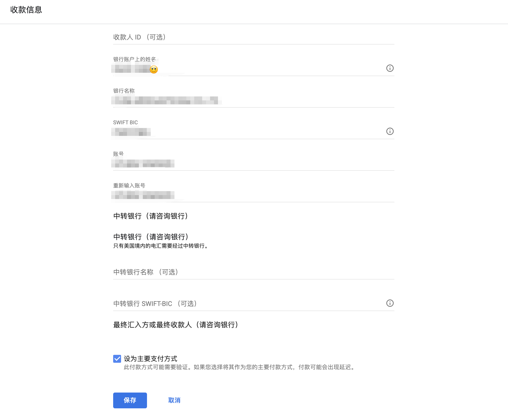

保存后，「支付方式」页面就会出现一条「电汇至银行账号 ••••xxxx」，标记为「主要」。

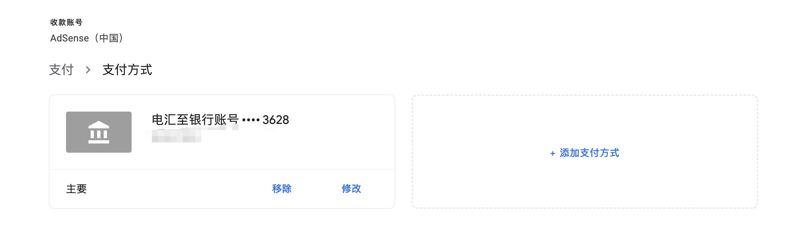

---

## 四、达到起付金额，收款到账

### 第 17 步：等待付款

余额达到 US$100 起付金额后，AdSense 首页会弹出「好消息！您已达到起付金额，即将收到付款」。上面的进度条也能看到：达到最低收入、身份验证、银行详细信息、达到最低付款额都已完成，最后一项「款项已付」正在进行中。

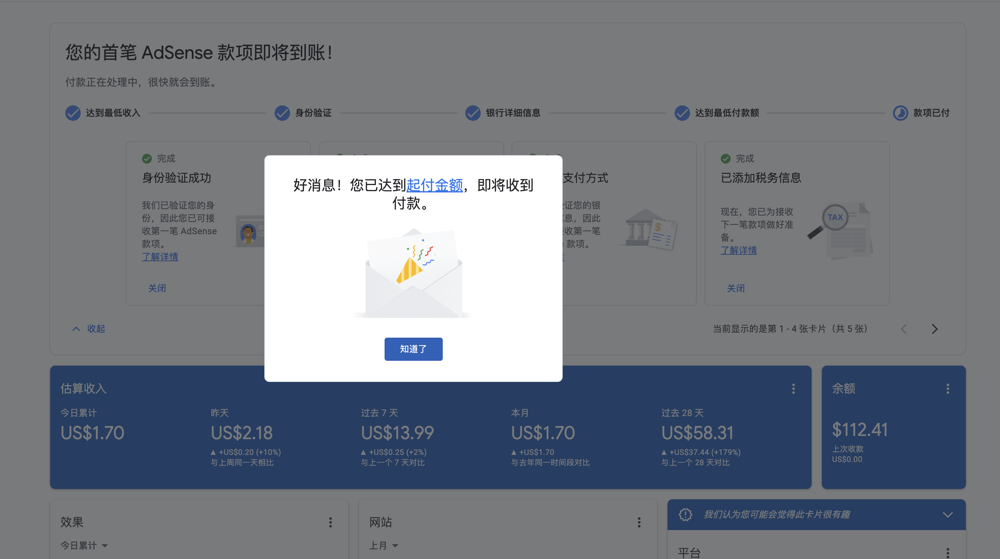

### 第 18 步：银行到账

过了一段时间，银行 App 里收到了一笔「汇入解付 / Google Asia Pacific Pte Limited」的美元入账，银行交易类型显示为「国际结算解付款项」。

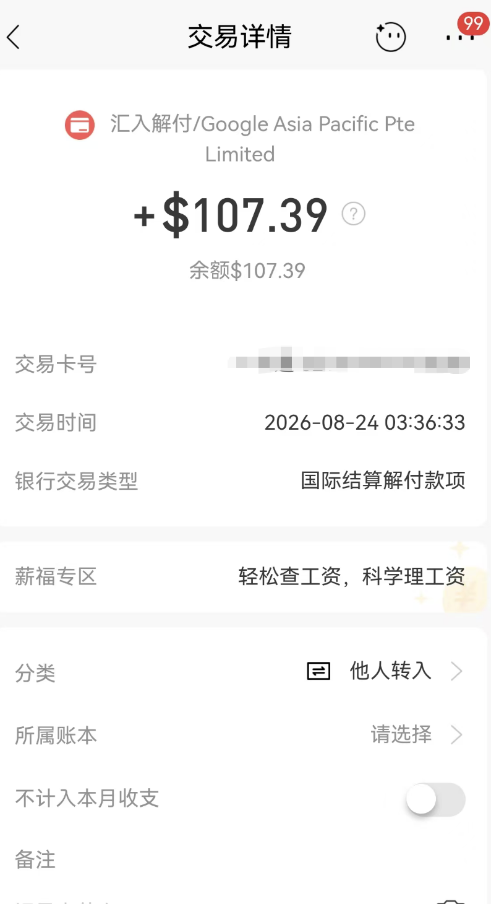

到这一步，整个收款流程就算跑通了。

---

## 常见问题 / 注意事项

1. **税务表里只能用英文字母和数字。** 姓名、地址都按这个规则写，带重音符号的字母用字母本身代替。
2. **姓名要和证件完全一致。** 我提交后因为「法定姓名和账号名称不符」被要求补传姓名证明，建议一开始就按护照拼写填好，不行就准备好护照或身份证明扫描件（PDF/PNG/JPEG，小于 50 MB）。
3. **外国纳税人识别号别留空。** 虽然页面标着「可选」，但要享受税收协定优惠就得填，中国个人填身份证号。
4. **税务协定要选对。** 「服务或其他商业收入」+ 第 7 条第 1 段 + 0%，否则默认按 30% 预扣。
5. **「在美国进行的活动和服务」选「否」。** 前提是你的工作确实都在美国境外完成。
6. **永久居住地址的 P.O. Box 复选框不要勾。**
7. **PIN 码只有有限的尝试次数。** 我的页面显示还可以再试 3 次，收到信再认真输入；没收到可以重新发送。
8. **身份验证需要几天。** 期间支付页面会一直挂着红色提示，等着就行，不影响收入累积。
9. **中转银行一般留空。** 页面说明只有美国境内电汇需要经过中转银行。
10. **到账以美元入账。** 我收到时是「汇入解付」，显示付款方是 Google Asia Pacific Pte Limited。

---

## 交流

有问题或者想一起交流出海、AdSense 的，欢迎加我微信（小树出海）：

